<a href="https://www.shreyash.codes/">
  <picture>
    <source media="(prefers-color-scheme: dark)" srcset="assets/header-dark.svg">
    
  </picture>
</a>

<p align="center">
  <a href="https://www.shreyash.codes/"></a>
  <a href="https://www.linkedin.com/in/shreyuu/"></a>
  <a href="mailto:shreyashmeshram0031@gmail.com"></a>
  <a href="https://shreyash-meshram.vercel.app/"></a>
</p>

```text
$ whoami --verbose
role      full-stack & AI engineer
base      nottingham, uk
studied   msc business analytics · university of nottingham   '26
          be computer engineering · sandip institute, nashik  '25
focus     backends, interfaces and applied ML that actually ship
speaks    en · hi · mr
status    open to full-time roles ●
```

### Results

Every project here takes something messy and turns it into a measurement.

| ch | project | input → output | stack |
|:--:|---|---|---|
| 00 | [**Feature drift via MCR**](https://github.com/shreyuu/UoN-Business-Analytics/tree/main/Dissertation)<br><sub>MSc dissertation</sub> | how a model uses its variables → a drift alarm before accuracy drops | Python · scikit-learn · SHAP · River |
| 01 | [**ZenSpend**](https://github.com/shreyuu/ZenSpend) | bank transactions → categories, with a local LLM so the data never leaves the machine | FastAPI · LangChain · pgvector · Ollama · React |
| 02 | [**FENgine**](https://github.com/shreyuu/FENgine) | photo of a chessboard → FEN + replayable PGN · ~97% val accuracy | FastAPI · OpenCV · PyTorch · React |
| 03 | [**FinCast AI**](https://github.com/shreyuu/FinCastAI) | market news + prices → sentiment and a price-movement signal | FastAPI · TypeScript · FinBERT · scikit-learn |
| 04 | [**BFSI Sentiment**](https://github.com/shreyuu/BFSI-NLP-Hackathon) | banking & insurance headline → positive / negative / neutral · ~95% accuracy | scikit-learn · XGBoost · LightGBM · BERT |
| 05 | [**Retail Segmentation**](https://github.com/shreyuu/retail-customer-segmentation) | 3,000 loyalty-card customers → 5 interpretable segments | Pandas · PCA · K-Means |
| 06 | [**Accident Black Spot Detection**](https://github.com/shreyuu/accident-black-spot-detection)<br><sub>newest</sub> | your location → a warning near accident-prone spots; every warning human-moderated | Expo · React Native · Next.js · Firebase · FastAPI |
| 07 | [**Statveil**](https://github.com/shreyuu/Statveil) | daily quests → levelled-up stats, streaks and a daily reset | Flutter · Dart |

<sub>All 18 projects, each with a case study → **[www.shreyash.codes](https://www.shreyash.codes/)**</sub>

### Instruments

<code>languages</code><br>
     

<code>backend · frontend</code><br>
 <picture><source media="(prefers-color-scheme: dark)" srcset="https://cdn.simpleicons.org/django/white"></picture> <picture><source media="(prefers-color-scheme: dark)" srcset="https://cdn.simpleicons.org/flask/white"></picture>   

<code>ml · data</code><br>
  <picture><source media="(prefers-color-scheme: dark)" srcset="https://cdn.simpleicons.org/scikitlearn/white"></picture> <picture><source media="(prefers-color-scheme: dark)" srcset="https://cdn.simpleicons.org/pandas/white"></picture>   <picture><source media="(prefers-color-scheme: dark)" srcset="https://cdn.simpleicons.org/langchain/white"></picture>  

<code>cloud · stores · tools</code><br>
      <picture><source media="(prefers-color-scheme: dark)" srcset="https://cdn.simpleicons.org/mysql/white"></picture>  
